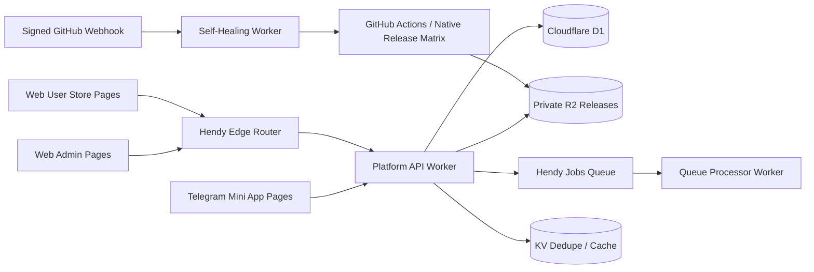

# HendyAppStore — kiến trúc hệ thống

## Mục tiêu

Monorepo PNPM triển khai **4 Cloudflare Workers + 3 Cloudflare Pages**. Telegram Bot Worker, webhook, command dispatcher và tin nhắn broadcast qua bot đã bị loại bỏ. Telegram Mini App vẫn là một giao diện riêng; Platform API tiếp tục xác minh Telegram WebApp `initData`.

## Sơ đồ luồng

## Ba Pages projects

| Project | Source | Vai trò |
|---|---|---|
| `hendy-web-admin` | `apps/web-admin` | Admin Studio, secret automation, maintenance, feature flags, audit/logs, releases |
| `hendy-mini-app` | `apps/mini-app` | Telegram WebApp, profile, check-in, tasks, referrals, notifications và minigames |
| `hendy-web-user` | `apps/web-user` | Storefront responsive, app detail và download portal |

## Bốn Workers

1. **`hendy-platform-api`** — REST API, xác thực Mini App `initData`, session/admin authorization, release tickets, D1/R2, feature flags, audit và WebSocket Durable Object.
2. **`hendy-queue-processor`** — Queue batches, bank/provider adapter, OTA workflow dispatch, retry/backoff và dead-letter. Không xử lý job gửi tin nhắn Telegram.
3. **`hendy-edge-router`** — maintenance guard, device/layout resolution và Service Binding tới Platform API.
4. **`hendy-self-healing-bot`** — HMAC-signed GitHub webhook, replay/dedupe và retry workflow/repository allowlist. Đây là dịch vụ tự khôi phục, không phải Telegram Bot.

## Shared resources

- D1 `hendyappstore-db`: dữ liệu người dùng/app, release metadata, wallet/ledger, tasks, notifications, audit và job status.
- R2 `hendy-app-releases`: private bucket cho binaries/backups; tải thông qua ticket ngắn hạn.
- KV `hendy-appstore-dedupe`: dedupe/cache bổ trợ; không dùng làm nguồn sự thật cho số dư.
- Queues `hendy-jobs` và `hendy-jobs-dlq`: công việc bất đồng bộ.
- Durable Object `AdminLiveSession`: WebSocket một chiều cho trạng thái audit/queue, chỉ admin đã xác thực mới được kết nối.

## Environment và secret handling

Admin form chỉ được gửi secret allowlist qua HTTPS. Backend mã hóa bằng GitHub repository public key (libsodium sealed box) trước khi cập nhật GitHub Actions Secrets. Không trả secret plaintext về UI, lưu trong D1, hoặc ghi vào log.

`BOT_TOKEN` vẫn cần nếu tiếp tục dùng Telegram Mini App, vì API kiểm tra chữ ký của `initData`. Token này chỉ thuộc Platform API; không còn `BOT_WEBHOOK_SECRET`, Telegram webhook hay secret cho Telegram Bot Worker.

## In-app notifications

Admin có thể tạo thông báo trong hộp thư Mini App. API ghi các bản ghi vào D1; Queue Processor không gửi Telegram messages. Các bản ghi cũ có job type `bot_broadcast` chưa xử lý nên được rà soát/dọn bằng migration vận hành riêng trước khi production queue được bật lại.

## Build và deploy

- Production: `.github/workflows/deploy-cloudflare.yml`
- CI: `.github/workflows/ci-test.yml`
- Runtime secret sync: `.github/workflows/secrets-sync.yml`
- Native release/signing: `.github/workflows/matrix-build.yml`

Pipeline provision/tái sử dụng D1/KV/R2/Queues, cấu hình Wrangler, áp migrations, deploy bốn Workers, đồng bộ secrets/webhook GitHub, build/deploy ba Pages và cập nhật URL/CORS. Không có Telegram webhook step.

## Native signing reality check

Signing secrets không tự tạo ứng dụng. APK/AAB, IPA, EXE/MSIX hoặc DMG/PKG cần mã nguồn native, runner/toolchain tương ứng, kiểm tra chữ ký và checksum. Các source roots native chưa có trong monorepo; không phát hành placeholder artifacts.
