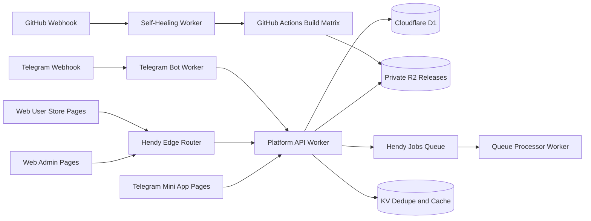

# HendyAppStoreBotTelegram — kiến trúc hệ thống

## Mục tiêu
Monorepo PNPM vận hành năm Cloudflare Workers và ba Cloudflare Pages projects. GitHub Actions điều phối deploy theo một pipeline production.

## Sơ đồ luồng


## Ba Pages projects
| Project | Source | Vai trò |
|---|---|---|
| `hendy-web-admin` | `apps/web-admin` | Admin Studio, secrets automation, maintenance, feature flags, logs, broadcast và release ops |
| `hendy-mini-app` | `apps/mini-app` | Telegram WebApp, profile, check-in, tasks, referrals, notifications và minigames |
| `hendy-web-user` | `apps/web-user` | Storefront responsive, app detail và download portal |

## Năm Workers
1. `hendy-platform-api`: REST API, Telegram initData verification, admin authorization, sessions, release tickets, D1/R2, feature flags và audit log.
2. `hendy-telegram-bot`: Telegram webhook, xác minh `X-Telegram-Bot-Api-Secret-Token` và dispatch command modules.
3. `hendy-queue-processor`: queue batches, broadcast, retry/backoff, DLQ, OTA orchestration và provider adapters.
4. `hendy-edge-router`: maintenance guard, device/layout resolution và service binding tới API.
5. `hendy-self-healing-bot`: HMAC-signed GitHub webhook, replay protection và chỉ retry workflow/repository allowlisted; không tự chạy mã tùy ý.

## Cloudflare resources
- D1 `hendyappstore-db`: dữ liệu nghiệp vụ và ledger; cập nhật số dư cùng ledger trong batch có ràng buộc duy nhất.
- R2 `hendy-app-releases`: bucket riêng tư; download qua ticket ngắn hạn, không bật public bucket để bỏ qua xác thực.
- KV `hendy-appstore-dedupe`: cache/dedupe phụ trợ, không dùng làm nguồn chuẩn cho số dư.
- Queues `hendy-jobs` và `hendy-jobs-dlq`: xử lý bất đồng bộ, retry và dead-letter.
- GitHub Actions: isolated runners và encrypted signing secrets.

## Environment sync và bảo mật
Admin form chỉ gửi secret allowlist qua HTTPS. Backend phải mã hóa bằng GitHub repository public key (libsodium sealed box) trước khi gọi Actions Secrets API. Không trả secret về UI, lưu plaintext trong D1 hoặc in ra log. Sau khi cập nhật GitHub Secrets, chạy `Sync Runtime Secrets` hoặc pipeline deploy để đẩy tới Workers.

Keystore/chứng chỉ chỉ được sử dụng trong runner cách ly. Không đưa private key vào browser, Pages assets, D1, KV hoặc log. Token phải có quyền tối thiểu; xoay mọi token từng xuất hiện trong Git history.

## Build và deploy
- Production workflow: `.github/workflows/deploy-cloudflare.yml`.
- CI: `.github/workflows/ci-test.yml`.
- Runtime secret sync: `.github/workflows/secrets-sync.yml` (manual, cần nhập `SYNC`).
- Security audit: `.github/workflows/security-checks.yml`.
- Domain sync: `.github/workflows/sync-domains.yml`.\n- Native release/signing matrix: `.github/workflows/matrix-build.yml` (manual; requires actual platform projects under `native/`).\n- Artifact manifest and checksum generation: `scripts/generate-release-manifest.mjs`; R2 publisher verifies SHA-256 before upload.

Pipeline tạo/tái sử dụng D1/KV/R2/Queues, cập nhật Wrangler IDs/vars, áp migration, deploy năm Workers, sync secrets, cấu hình Telegram/GitHub webhooks, build/deploy ba Pages và đồng bộ CORS cuối cùng. Không chạy hai production pipeline đồng thời.

## Local development
Yêu cầu Node.js 22.12+ và pnpm 10.18.0.
```bash
corepack enable
corepack prepare pnpm@10.18.0 --activate
pnpm install --no-frozen-lockfile
pnpm run preflight:cloudflare
pnpm check
pnpm test
pnpm --filter @hendy/web-admin build
pnpm --filter @hendy/mini-app build
pnpm --filter @hendy/web-user build
```

## Native signing
Signing secrets không tự tạo app native. Workflow matrix kiểm tra chữ ký và tạo manifest/checksum, sau đó upload file cùng manifest vào private R2. APK/AAB, IPA, EXE/MSIX hoặc DMG/PKG vẫn cần source project tương ứng tại `native/android`, `native/ios`, `native/windows`, `native/macos`; các source roots này hiện chưa có trong monorepo nên target sẽ dừng rõ ràng thay vì phát hành placeholder artifacts. iOS/macOS cần runner macOS, signing material, provisioning/notarization hợp lệ.

## Realtime admin monitoring

The Platform API exports `AdminLiveSession`, a Durable Object defined in `workers/platform-api/src/realtime/ws-durable-object.js`. The API checks the signed user session and administrator allowlist before it forwards `/api/admin/live/ws` to the Durable Object. The browser token is carried in an authentication subprotocol (not a query string) and stripped before forwarding. The stream emits only sanitized audit/queue status metadata; it is read-only from the browser side.

The Queue Processor binds the same object using `script_name = "hendy-platform-api"`, which lets queue job transitions emit `processing`, `queued`, `retry`, `completed` and `dead_letter` status events to admin sessions.

## Worker development commands

See [DEVELOPMENT.md](DEVELOPMENT.md) for per-Worker dev/deploy/tail commands, CI dry-runs, GitHub CLI workflows, Pages builds, runtime secrets and post-deployment smoke tests.
